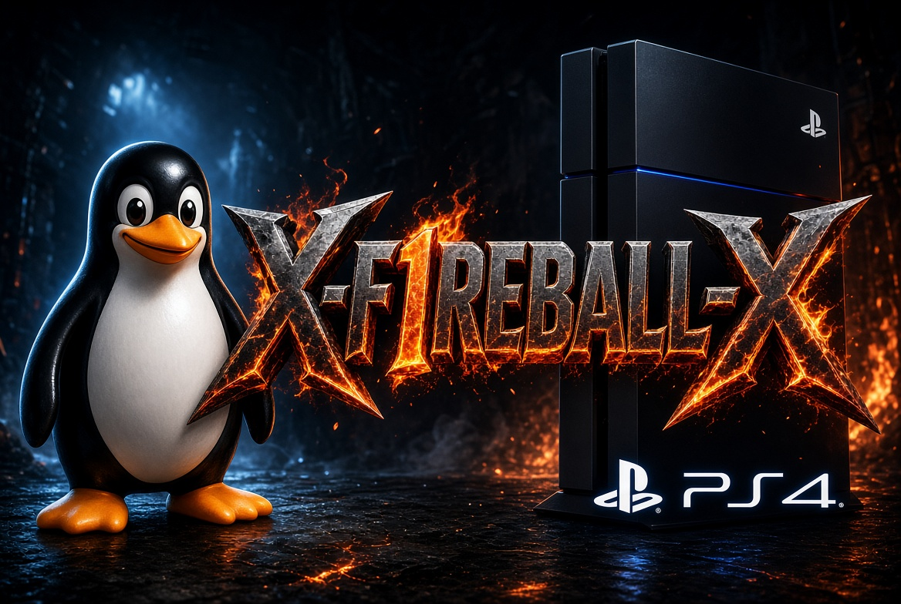

<p align="center"></p>

# PS4 Linux

Run Linux (Arch Linux with KDE Plasma) on a jailbroken PS4 from a USB drive. Tested setup, ready-to-use files.

## Tested consoles

| Model | Type | Southbridge | Kernel | Tested FW | Status |
|---|---|---|---|---|---|
| CUH-7116B | Pro | Belize | `bzImage-belize-7.1.7` | 13.52 (GoldHEN) | Works |
| CUH-2116A | Slim | Baikal | `bzImage-baikal-7.0.8` | 13.52 (GoldHEN) | Works |

Both use the same payload (`linux-1024mb.elf`), initramfs and USB drive. The loader supports FW 5.05 - 13.52. More consoles will be added.

## Which kernel do I need

| Southbridge | Kernel |
|---|---|
| Belize (or Aeolia) | `bzImage-belize-7.1.7` |
| Baikal | `bzImage-baikal-7.0.8` |

- The model number alone does not decide it: Slim (CUH-2xxx) and Pro (CUH-7xxx) can be Belize or Baikal, depending on the motherboard. Fat CUH-10xx/11xx are Aeolia, CUH-12xx and Pro CUH-70xx are Belize.
- Easiest check: if the Belize kernel gets a white light every time, use the Baikal kernel.
- On the console, the kernel must always be named `/data/linux/boot/bzImage`.
- Do not put a file named `bzImage` on the USB. The loader prefers a USB kernel over `/data/linux/boot/`, so leave it off and one USB works on every console.

## Download

Get all files from [Releases](../../releases/latest):

- `bzImage-belize-7.1.7`, `bzImage-baikal-7.0.8` - kernels
- `initramfs.cpio.gz` - initramfs (shared)
- `linux-*mb.elf` - payloads
- `build-img.sh`, `write-img.ps1` - USB image tools
- `SHA256SUMS` - checksums

A ready-made USB image (`psxitarch-usb.img`) will be added to Releases later.

## Payloads

| File | VRAM | Use |
|---|---|---|
| `linux-32mb.elf` - `linux-512mb.elf` | 32 - 512MB | Headless / server only |
| `linux-1024mb.elf` | 1GB | **Recommended for KDE.** Tested on Pro and Slim |
| `linux-2048mb.elf` | 2GB | More graphics memory |
| `linux-3072mb.elf` | 3GB | Not tested |
| `linux-4096mb.elf` | 4GB | Tested on Pro (FW 13.52). Heavy games / emulators. Leaves about 4GB RAM |

## Installation

### 1. Prepare the USB drive (16GB or more)

- **Ready-made image (coming soon):** download `psxitarch-usb.img` from Releases, then go to step 2.
- **Build it yourself:** get Erkkola's Arch KDE v1.1.1 rootfs `psxitarch.tar.xz`, then in WSL or Linux:

```bash
sudo bash build-img.sh psxitarch.tar.xz initramfs.cpio.gz psxitarch-usb.img
```

This creates a 12GB image: p1 FAT32 with `initramfs.cpio.gz`, p2 ext4 labeled `psxitarch` with Arch KDE.

### 2. Write the image to the USB (Windows)

In PowerShell as Administrator, find the USB disk number with `Get-Disk`, then:

```powershell
powershell -ExecutionPolicy Bypass -File .\write-img.ps1 -ImagePath .\psxitarch-usb.img -DiskNumber 1
```

The script refuses non-USB or system disks and asks you to confirm. If Windows offers to format the drive, click Cancel.

### 3. Copy the kernel and initramfs to the PS4

1. Jailbreak the PS4 with GoldHEN.
2. Connect with FTP to the PS4 IP, port `2121` (binary mode).
3. Create `/data/linux/boot/`.
4. Upload the kernel for your southbridge as `/data/linux/boot/bzImage`.
5. Upload `initramfs.cpio.gz` to `/data/linux/boot/`.

### 4. Boot Linux

1. Plug the USB into the PS4.
2. Send `linux-1024mb.elf` to the GoldHEN BinLoader:

```bash
nc -q 1 <PS4-IP> 9020 < linux-1024mb.elf
```

Port 9020 worked here. If it does not answer, try 9090.

3. Log in with user `abc`, password `abc`.

### 5. Expand the root partition

Check the names with `lsblk` (the USB was `sdb` here), then:

```bash
sudo parted /dev/sdb resizepart 2 100%
sudo resize2fs /dev/sdb2
```

### 6. After installation

- **DualShock 4:** works over USB. Over Bluetooth it must be paired again on every boot.
- **Network:** Ethernet works out of the box. Wi-Fi is still in testing - prefer 2.4GHz. If it is stuck on "Configuring interface":

```bash
sudo nmcli con modify "SSID" wifi.cloned-mac-address permanent wifi.powersave 2
```

- **Back to Linux after a reboot:** rebooting returns to the PS4 system. Jailbreak, plug in the USB and send the payload again.

## Troubleshooting

- **Black screen or white light:** Linux does not always start after the jailbreak. This is normal. Do a full power off (hold the power button), wait a few seconds, jailbreak again and retry. The 2nd or 3rd try usually works.
- **Best routine:** plug the USB in before powering on. Send the ELF right after the jailbreak, without opening games or apps. Wait 1-2 minutes on a black screen before giving up.
- **White light every time:** probably the wrong kernel for your southbridge - try the other one.
- **Rescue shell with `mounting LABEL=psxitarch failed`:** the USB was not connected or detected. Plug it in and reboot (resume-boot does not help).
- **Sleep / suspend is not supported:** disable it in KDE Power Management, or run:

```bash
sudo systemctl mask sleep.target suspend.target hibernate.target hybrid-sleep.target
```

- **Pasted commands add junk characters:** type them by hand.

## Credits

- **rmuxnet** - Strawberry kernels (7.1.7 Aeolia/Belize, 7.0.8 Baikal port). GPL-2.0, source: rmuxnet/linux on GitLab
- **pask** - the 7.0.8 Baikal FullLTO build used here
- **DionKill** - better-initramfs ("External HDD" variant) and the PS4 Linux Tutorial
- **Erkkola (ErkkolaMaitohappo)** - Arch KDE v1.1.1
- **ArabPixel and the ps4-linux team** - ps4-linux-loader payloads
- **GoldHEN - SiSTR0** - homebrew enabler, FTP server and BinLoader

All binaries are unmodified and belong to their authors.
