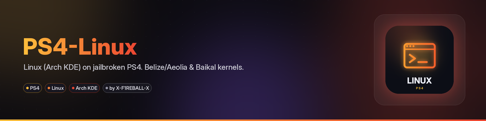
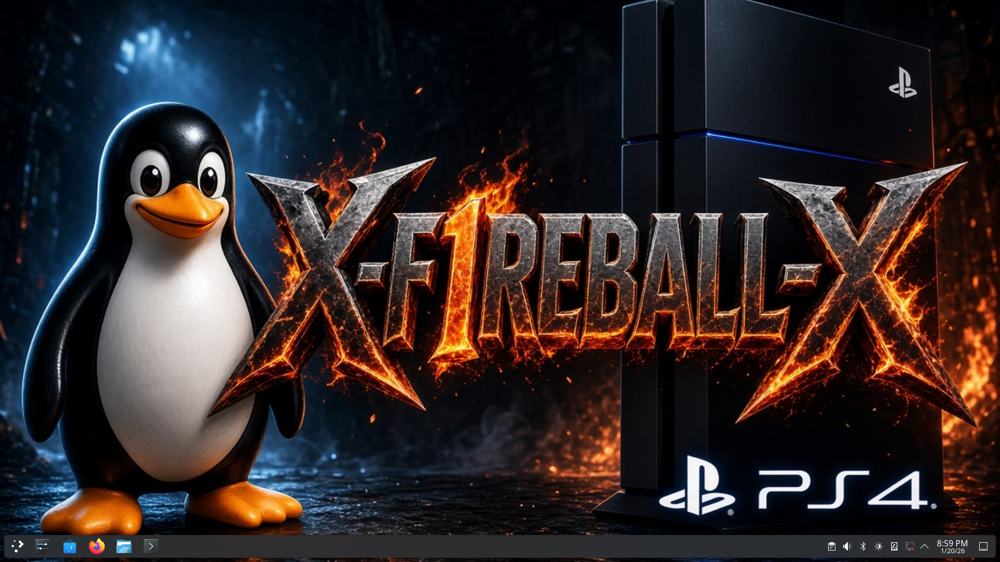

Run Linux (Arch Linux with KDE Plasma) on a jailbroken PS4 from a USB drive. Tested setup, ready-to-use files.

<p align="center"></p>

## Quick start

1. Burn the USB image to a 16GB or larger stick.
2. FTP the kernel for your console to `/data/linux/boot/bzImage`, plus `initramfs.cpio.gz`.
3. Plug in the USB, jailbreak, and send `linux-1024mb.elf` to the loader.

Everything else is in the [guide](https://x-f1reball-x.github.io/PS4-Linux/).

## Contents

- [Features](#features)
- [Requirements](#requirements)
- [Which kernel, and what the light means](#which-kernel-and-what-the-light-means)
- [Download](#download)
- [Installation](#installation)
- [Payloads](#payloads)
- [After it boots](#after-it-boots)
- [Troubleshooting](#troubleshooting)
- [What's new](#whats-new)
- [License](#license)
- [Credits](#credits)

## Features

- Arch Linux with KDE Plasma, booted from USB.
- Kernels for Belize (`bzImage-belize-7.1.7`) and Baikal (`bzImage-baikal-7.0.8`). One USB works on both.
- Payloads from 32MB to 4096MB VRAM. `linux-1024mb.elf` is the one for the desktop.
- Works on CUH-7116B (Pro) and CUH-2116A (Slim) on FW 13.52 with GoldHEN. The loader supports FW 5.05-13.52.

## Requirements

- A jailbroken PS4 with GoldHEN (FTP on port `2121` and a payload loader).
- A USB stick: 32GB USB 3.0 is best, 16GB is the minimum.
- A Linux or Windows WSL machine to build the image, and Windows or another tool to burn it.

## Which kernel, and what the light means

After you send the payload, watch the light on the PS4.

If it turns from white to blue within about 15 seconds, the kernel started and Linux is loading.

If the light stays white for more than 20 seconds, check that the kernel matches the console using the table below.

If it stays white, you can also power off, turn the console back on, and try again.

Only two models are known to work. Everything else in this table is untested.

| Model | Type | Southbridge | Kernel | Status |
|---|---|---|---|---|
| CUH-10xx, CUH-11xx | Fat | Aeolia | `bzImage-belize-7.1.7` | Untested |
| CUH-12xx | Fat | Belize | `bzImage-belize-7.1.7` | Untested |
| CUH-2116A | Slim | Baikal | `bzImage-baikal-7.0.8` | Works (FW 13.52, GoldHEN) |
| Other CUH-2xxx | Slim | Depends on the motherboard | Belize: `bzImage-belize-7.1.7`. Baikal: `bzImage-baikal-7.0.8`. | Untested |
| CUH-70xx | Pro | Belize | `bzImage-belize-7.1.7` | Untested |
| CUH-7116B | Pro | Belize | `bzImage-belize-7.1.7` | Works (FW 13.52, GoldHEN) |
| Other CUH-7xxx | Pro | Depends on the motherboard | Belize: `bzImage-belize-7.1.7`. Baikal: `bzImage-baikal-7.0.8`. | Untested |

Fat CUH-10xx and CUH-11xx are Aeolia, so they should use the Belize kernel. That has not been tested. Some Fat models have Wi-Fi and Bluetooth chips that may not work.

Slim CUH-2xxx and Pro CUH-7xxx can be either Belize or Baikal. CUH-70xx is Belize. For the other Slim and Pro models, it depends on the motherboard, so the model number alone is not enough.

Both tested consoles use the same payload (`linux-1024mb.elf`), initramfs and USB drive. The loader supports FW 5.05-13.52.

On the console, the kernel must always be named `/data/linux/boot/bzImage`.

Do not put a file named `bzImage` on the USB. The loader prefers a USB kernel over `/data/linux/boot/`, so leave it off and one USB works on every console.

## Download

Get everything from [Releases](../../releases/latest). All files are loose (no zips).

| File | What it is |
|---|---|
| `psxitarch-usb.img.xz.part1`, `psxitarch-usb.img.xz.part2` | Ready-made Arch Linux KDE USB image, xz-compressed, split in 2 parts. Join them before burning. |
| `bzImage-belize-7.1.7`, `bzImage-baikal-7.0.8` | Kernels. Pick the one for your console. |
| `initramfs.cpio.gz` | The small boot file. |
| `linux-*mb.elf` (32 to 4096) | The payloads you send to the PS4. Use `linux-1024mb.elf`. |
| `write-img.ps1` | Windows script that burns the image to USB. |
| `build-img.sh` | Script to build the USB image yourself (optional). |
| `kernel-7.1.7-Strawberry-General.config` | Kernel config. |
| `SHA256SUMS` | Checksums. |

Do not put a file named `bzImage` on the USB. The PS4 would boot that file instead of the kernel that matches the console. One USB then works for both Belize and Baikal.

### Which USB

- Best: a 32GB USB 3.0 stick. Fast, and there is room left after Linux is installed.
- Minimum: 16GB. It fits, but there is almost no free space until you grow the partition.
- Slower USB 2.0 sticks work, but boot and the desktop feel slow.

Burning erases the whole stick.

## Installation

### 1. Join the image parts

Windows:

```
cmd /c copy /b psxitarch-usb.img.xz.part1 + psxitarch-usb.img.xz.part2 psxitarch-usb.img.xz
```

Linux:

```bash
cat psxitarch-usb.img.xz.part1 psxitarch-usb.img.xz.part2 > psxitarch-usb.img.xz
```

### 2. Burn it

**Windows**

1. Open PowerShell as Administrator.
2. Run `Get-Disk` and note the number of the USB stick. Do not pick your PC disk.
3. Run (needs 7-Zip):

```powershell
powershell -ExecutionPolicy Bypass -File .\write-img.ps1 -ImagePath .\psxitarch-usb.img.xz -DiskNumber 1
```

Change `1` to your USB number. If Windows asks to format the stick, click Cancel.

Or extract the `.img` with 7-Zip and burn it with balenaEtcher, or with Rufus in DD mode.

### 3. Put the kernel on the PS4

The kernel stays on the console, not on the USB.

1. Jailbreak with GoldHEN.
2. FTP to the PS4, port `2121`.
3. Create the folder `/data/linux/boot/`.
4. Upload the kernel for your console and name it `/data/linux/boot/bzImage`.
5. Upload `initramfs.cpio.gz` to `/data/linux/boot/initramfs.cpio.gz`.

Belize uses `bzImage-belize-7.1.7`. Baikal uses `bzImage-baikal-7.0.8`. If the light stays white for more than 20 seconds, check the table and use the kernel that matches the console. You can also power off, turn the console back on, and try again.

### 4. Boot

1. Plug the USB into the PS4 before you turn it on.
2. Jailbreak.
3. Send `linux-1024mb.elf` to the loader:

```bash
nc -q 1 <PS4-IP> 9020 < linux-1024mb.elf
```

If port 9020 does not answer, try 9090. A black screen for a minute or two is normal. It then logs in to the KDE desktop.

After a reboot you are back on the PS4. Jailbreak and send the payload again. The USB can stay plugged in.

### 5. Use the rest of the USB

Do this only after Linux is running on the PS4, not from the PC. The image is about 12GB. On a larger stick, the space after that stays unused until you grow the Linux partition.

Grow only the partition whose label is `psxitarch`. That is partition 2 of the USB stick. Never touch the console's internal disk.

These commands were not run on the console. They are the usual ones. Run `lsblk -f` and replace `sdX` with the disk that shows the label `psxitarch`, not a partition name like `sdX1`:

```bash
lsblk -f
sudo parted /dev/sdX resizepart 2 100%
sudo resize2fs /dev/sdX2
```

If parted asks whether to continue because the partition is in use, answer yes. This only grows that USB partition.

## Payloads

| File | VRAM | Use |
|---|---|---|
| `linux-32mb.elf` to `linux-512mb.elf` | 32-512MB | No desktop. Server only. |
| `linux-1024mb.elf` | 1GB | Use this for the desktop. Tested on Pro and Slim. |
| `linux-2048mb.elf` | 2GB | More graphics memory. |
| `linux-3072mb.elf` | 3GB | Not tested. |
| `linux-4096mb.elf` | 4GB | Tested on Pro (FW 13.52). Heavy games and emulators. Leaves about 4GB RAM. |

## After it boots

- The controller works on a USB cable. Bluetooth has to be paired again after every boot.
- Ethernet works. Wi-Fi is still being tested. Prefer 2.4GHz.
- Sleep is turned off. Suspending the console breaks this Linux.

## Troubleshooting

- **Black screen:** Linux does not always start after the jailbreak. This is normal. Do a full power off (hold the power button), wait a few seconds, jailbreak again and retry. The 2nd or 3rd try usually works.
- **Best routine:** plug the USB in before powering on. Send the ELF right after the jailbreak, without opening games or apps. Wait 1-2 minutes on a black screen before giving up.
- **White light:** If it turns from white to blue within about 15 seconds, the kernel started and Linux is loading. If it stays white for more than 20 seconds, check that the kernel matches the console using the table. If it stays white, you can also power off, turn the console back on, and try again.
- **Rescue shell with `mounting LABEL=psxitarch failed`:** the USB was not connected or detected. Plug it in and reboot (resume-boot does not help).
- **Sleep / suspend is not supported:** already disabled in the ready-made USB image (suspend, screen dimming and screen off are turned off). If you build your own image, disable it in KDE Power Management, or run:

```bash
sudo systemctl mask sleep.target suspend.target hibernate.target hybrid-sleep.target
```

- **Pasted commands add junk characters:** type them by hand.

## What's new

This file contains the latest Linux update, dated 29/09/2026. See the [releases page](../../releases) for each version.

## License

The `LICENSE` file contains the GNU General Public License, version 3.

## Credits

- **fail0verflow (marcan, shuffle2)** - original PS4 Linux kernel port and ps4-kexec (the base of the loader)
- **rancido and PSXITA Team, eeply, valeryy, tihmstar, mircoho, codedwrench, crashniels** - PS4 kernel patches (amdgpu, Pro/Slim video, HDMI audio, Baikal and Belize support) carried into today's kernels
- **rmuxnet** - Strawberry kernels (7.1.7 Aeolia/Belize, Baikal port to 7.0.8) and the firmware/southbridge agnostic loader rework
- **ps4boot** - original ps4-linux-payloads loader
- **ArabPixel** - ps4-linux-loader maintainer, FW 12.5x and 13.00-13.52 support
- **PSXITA Team (Rancido)** - Psxitarch v3 initramfs and install scripts
- **Piotr Karbowski** - better-initramfs
- **Erkkola (ErkkolaMaitohappo)** - Arch Linux KDE v1.1.1 rootfs
- **centi07 and DionKill** - PS4 patched Mesa and video driver packages
- **SiSTR0** - GoldHEN (jailbreak, FTP server, BinLoader)

Kernels, payloads and initramfs are unmodified and belong to their authors.

Maintained by [X-F1REBALL-X](https://github.com/X-F1REBALL-X).
